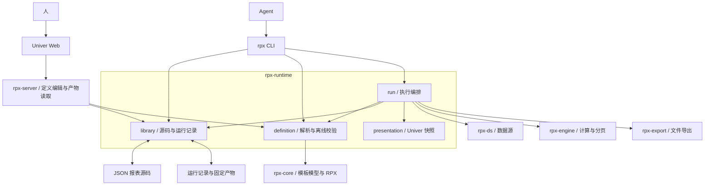

# 面向 agent 的 RPX CLI 设计提案

状态：已实施第一、二层本地命令与目录库/Web 闭环。日期：2026-10-17。

使用与验证见 [agent-cli.md](agent-cli.md)。RPX 导入逐字段重建比较；不能表达的字段显式拒绝。

建议将现有 `rpx-cli` 重建为安装名为 `rpx` 的 Rust 命令行工具。**agent 全程管理报表，
并通过 CLI 调用 Rust 引擎执行；人通过 Univer Web 观察、修正定义和查看已保存的运行结果。**
CLI 提供确定性的模板管理、检查、计算、导出和结果查询；Web 保存定义与读取产物，
不承担报表引擎的执行调度。

本次范围补充：**JSON 是报表定义的唯一编辑与存储格式，第一版包含预制报表库管理。**
RPX 用于显式导入和按需导出。模板库保存 JSON 源码，日常生成直接从 JSON 构造
`ReportDefine` 并运行，不再先转换为 RPX。每次运行绑定确定的源码修订，保存结果与
Univer 展示快照。设计已实施；旧 BLOB 存库与 Web 直接执行入口已移除。第 2 节保留实施前基线供对照。

## 1. 要完成的工作

agent 应能完成以下循环：

1. 列出、查找和复制预制报表，查询当前版本支持的模板字段、函数和示例。
2. 读取模板网格、数据集、公式、扩展方向及左、上主格。
3. 生成或修改 JSON 定义，读取并保留人通过 Web 保存的修正。
4. 在加载业务数据前检查定义；运行后检查实际扩展与计算结果。
5. 根据结构化诊断修改定义，重新运行，保存结果与展示快照，按需交付 XLSX、CSV。

| 参与方 | 职责 |
| --- | --- |
| agent | 管理预制报表、定义数据集与公式、处理主格关系、校验、执行引擎、检查和修正结果 |
| 人 / Univer Web | 查看与修正定义，查看修订状态、运行记录、结果、诊断，下载已生成文件 |
| Rust CLI / 引擎 | 按确定的定义和输入完成取数、计算、分页、快照与导出，记录运行证据 |

人保存定义不会自动运行引擎。agent 下一次读取报表状态时发现修订变化，再决定执行。
第一版不假设存在常驻 agent、目录监听器或自动任务调度；Web 关闭也不影响 agent 工作。

核心区分：模板地址、计算结果地址、打印页地址是三套坐标。命令必须明确使用哪一套。
模板格可以对应多个结果实例，主格也可以位于右侧或下方，不能靠界面位置猜测关系。

## 2. 现有能力与缺口

| 位置 | 已有能力 | CLI 需要做的事 |
| --- | --- | --- |
| [`rpx-cli/src/main.rs`](../crates/rpx-cli/src/main.rs) | 手工参数解析；`print`；RPX 到 CSV/XLSX | 改用标准参数解析、统一输出；接入 JSON、参数、宏和 SQL |
| [`reportdef.rs`](../crates/rpx-server/src/reportdef.rs) | JSON/RPX 内容识别、JSON 定义装配、宏表 | 移到公共层，CLI 执行与 Web 离线定义检查复用 |
| [`http.rs`](../crates/rpx-server/src/http.rs) | SQL 预取、数据集装载、`calculate_full`、模板口径分页 | 抽出与 HTTP 无关的运行函数 |
| [`form.rs`](../crates/rpx-server/src/form.rs) | JSON 参数到 `ParamTable` | 抽出参数类型转换，移除旧执行表单入口 |
| [`datasource.rs`](../crates/rpx-server/src/datasource.rs) | 数据源配置、连接注册表 | 复用配置与取数规则 |
| [`calc_grid.rs`](../crates/rpx-engine/src/arena/calc_grid.rs) | `origin`、结果坐标、类型化值、主格出处 | 映射为 agent 能查询的结果文件 |
| [`rpx-export`](../crates/rpx-export/src/lib.rs) | CSV、普通 XLSX、打印 XLSX | 共用现有导出器 |
| [`snapshot.rs`](../crates/rpx-server/src/snapshot.rs) | 计算矩阵转 Univer 工作簿，含样式、图形与分页 | 移到公共展示模块，由 agent 运行时保存快照 |
| [`template.ts`](../web/src/template.ts) | Web 保存和编辑 JSON 模板 | 保持同一份模板字段与主格语义 |

当前 CLI 的实际可执行文件名来自 Cargo 包名 `rpx-cli`；文档注释中的 `rpx` 尚不是
显式配置的二进制名。实施时用 `[[bin]] name = "rpx"` 明确安装名。

现有 `render` 直接调用 RPX 读取器，传入空参数表且不提供 SQL 通道，未接入完整宏入口。
给旧命令增加一个 JSON 输出开关不足以完成上述循环。

## 3. 命令面

默认输出 JSON；使用 `--output text` 查看人类可读摘要。`--help` 和 `--version` 输出文本。
文件命令使用明确的 JSON 路径；预制报表命令使用库目录和稳定 ID。
第一版使用目录管理，源码与运行记录分开保存，不引入项目数据库、后台会话或隐式的“当前报表”。

### 3.1 文件命令（第一版）

| 命令 | 职责 |
| --- | --- |
| `rpx doctor` | 报告版本、支持格式、运行能力和配置状态；本地文件模式无需服务与登录 |
| `rpx schema template` | 返回随二进制发布的模板 JSON Schema；使用者读取响应的 `data.schema` |
| `rpx template inspect <file> [--cell C6] [--limit 50] [--offset 0]` | 模板摘要或指定模板格；给出原始 JSON Pointer |
| `rpx template validate <file> [--params-file <file>]` | 离线定义校验，报告已经检查和尚未检查的项目 |
| `rpx run <file.json> --out-dir <dir> [--data-dir <dir>] [--params-file <file>] [--datasources <file>] [--export xlsx]` | 从 JSON 一次取数、计算、分页，保存运行记录、结果与展示快照；`--export` 可重复指定 |
| `rpx result inspect <result.json> [--range A1:K20] [--origin E6] [--limit 50] [--offset 0]` | 查询已保存的结果，按结果范围或模板出处筛选 |

独立文件模式下，agent 可以通过自己的文件工具编写完整 JSON 定义，调用 `validate`
检查后再运行。进入共享报表库后，通过带修订检查的库命令更新，避免绕过并发保护。
Web 的日常结果页读取报表库中的运行记录；独立文件输出不自动登记到库。

`template inspect` 中的 `--cell` 始终指模板地址。`result inspect` 中的 `--range`
始终指计算结果地址，`--origin` 始终指模板地址；同时指定时取交集。
结果查询默认包含模板出处与左、上主格出处，但不把它们伪装成运行实例 ID。
模板 inspect 区分“显式声明”和“尚待引擎推导”：未填写的主格不能直接解释成根主格。
实际生效关系以运行结果为准。

列表默认最多返回 50 项，`--limit` 上限为 500，超过上限显式报参数错误。
输出携带 `returned`、`total`、`next_offset`，按行、列顺序稳定分页。
截断只影响命令响应，落盘的结果文件仍保留完整结果。

### 3.2 第二层能力

| 命令 | 职责 |
| --- | --- |
| `rpx catalog functions [--name sum] [--limit 50] [--offset 0]` | 查询已实现函数、调用方式、例子和限制 |
| `rpx catalog examples` | 列出随安装发布的例子及其稳定 ID |
| `rpx template create --example <id> --out-dir <dir>` | 将示例模板和配套数据一起写入新目录 |
| `rpx template patch <file> --patch-file <file> --out <file> [--dry-run]` | 标准 JSON Patch；在内存中应用并完成定义校验后写新模板 |
| `rpx dataset inspect <template> --name ds1 [--data-dir <dir>] [--datasources <file>] [--limit 5]` | 使用模板的数据集规则检查字段、行数与样本 |
| `rpx template compile <file.json> --out <file.rpx>` | 使用现有 RPX 写器编译交付文件 |

函数目录不能直接把 `expr::names::REGULAR`、`DS` 全表标记为“支持”。这些表包含解析器
认识、但求值器未必实现的产品函数。目录要以实际求值分支和有效用例为依据。
对于部分实现，必须列出限制，不补猜测的函数签名。

示例文件应随二进制打包，例如使用 `include_str!` / `include_bytes!`，从任意目录运行
都能创建，不能依赖开发仓库恰好存在。

### 3.3 后续能力

出现跨机器使用的实际需求时，再为 `report` 命令增加显式远程入口，例如与 `--library`
互斥的 `--server`，以及只读 `rpx api get`。本地 `run` 保持本地语义。
服务端目前只有模板列表、入库与参数元数据等接口；第一版模板库需要补齐定义源码
保存、读取接口，不能把 RPX 资产详情当作完整 JSON 源码。

MCP 可以以后适配同一运行层。CLI 第一版无需运行自己的模型、规划器或聊天循环。

## 4. 输入与输出协议

### 4.1 输入

复杂输入使用 UTF-8 JSON 文件，避免把长公式、列表和 SQL 拼成 shell 参数：

```sh
rpx template validate ./report.json --params-file ./params.json
rpx run ./report.json --data-dir ./data --params-file ./params.json \
  --out-dir ./out/run-001 --export xlsx --export csv
```

`--params-file`、`--patch-file` 支持 `-`，表示读 stdin；一条命令只有一个 stdin 输入。
第一版模板本身使用文件路径，保证相对数据文件的基准明确。

相对命令行路径从当前工作目录解析；未指定 `--data-dir` 时，模板内数据文件相对
模板所在目录解析。响应中的产物路径使用绝对路径。

参数值使用 JSON 的显式类型：`10`、`"10"`、`null` 和 `[1,2]` 不互相猜测。
复用现有参数转换规则，对象形态显式拒绝，并补齐整数溢出的结构化诊断。
模板参数 `default` 当前保存的是字符串元数据，第一版要求调用方传入实际值；
不新增只在 CLI 生效的默认值推断。若增加默认值绑定，Web 的参数编辑与 CLI 执行
必须遵循同一类型契约。

本地文件模式不需要认证。SQL 模式显式使用 `--datasources`，沿用现有配置结构；
模板只引用数据源名称。第一版不隐式加载工作目录中的连接配置，`doctor` 不主动连接数据库。

### 4.2 统一响应

每次正常完成的调用只向 stdout 写一个 JSON 对象，成功、校验失败和参数错误遵循
同一外层结构。进度与调试日志写 stderr。强制终止、进程崩溃不能承诺有完整 JSON 响应。

成功示意，数值为复杂示例的预期结果，耗时仅为示意：

```json
{
  "protocol_version": 1,
  "ok": true,
  "command": "run",
  "data": {
    "template_grid": { "rows": 12, "cols": 11 },
    "result_grid": { "rows": 23, "cols": 25 },
    "artifacts": [
      { "kind": "run", "path": "/tmp/rpx-run-001/run.json" },
      { "kind": "result", "path": "/tmp/rpx-run-001/artifacts/result.json" },
      { "kind": "workbook", "path": "/tmp/rpx-run-001/artifacts/workbook.json" },
      { "kind": "xlsx", "path": "/tmp/rpx-run-001/artifacts/report.xlsx" }
    ]
  },
  "diagnostics": [],
  "error": null,
  "meta": { "duration_ms": 35 }
}
```

失败示意：

```json
{
  "protocol_version": 1,
  "ok": false,
  "command": "template.validate",
  "data": null,
  "diagnostics": [
    {
      "severity": "error",
      "code": "HEAD_TARGET_MISSING",
      "stage": "definition",
      "template_cell": "C6",
      "field": "left_head",
      "json_pointer": "/cells/17/left_head",
      "message": "主格 D6 不存在",
      "hint": "检查 D6 的定义，或修改 C6 的左主格"
    }
  ],
  "error": { "code": "TEMPLATE_INVALID", "message": "模板校验失败" },
  "meta": {}
}
```

错误示例沿用当前复杂模板中 C6 的数组位置。实际 Pointer 必须根据输入文件定位，
不能从格号推算数组下标。错误 `code`、`stage`、坐标是机器协议，`message` 是解释文字。

`retryable` 仅在能够确定时给出。未知原因不自动重试取数，也不建议 agent 自动改写业务公式。

| 退出码 | 含义 |
| --- | --- |
| 0 | 命令成功；查询结果为空也算成功 |
| 1 | 内部错误 |
| 2 | 命令或参数用法错误 |
| 3 | 模板结构、公式准备或主格校验失败 |
| 4 | 输入数据、参数绑定或数据源取数失败 |
| 5 | 计算或分页失败 |
| 6 | 本地文件读写或导出失败 |
| 7 | 源码修订冲突；重新读取后再决定修改或运行 |

分类取决于失败阶段，具体原因读取 `error.code` 与 `diagnostics`。
使用 clap 的可返回错误解析入口，避免参数错误绕过 JSON 协议直接打印 usage 并退出。

### 4.3 Schema 与校验覆盖

模板 Schema 随版本固定发布，第一版用 `include_str!` 嵌入契约文件。
它描述字段结构，不承担合并区冲突、主格方向和循环等语义校验。
语义判定复用公共定义装载器和引擎，不能在 CLI 再写一套主格算法。
Schema 与现有正、反例进行契约检查，特别检查装载器接受的合法结构不会被 Schema 误拒。

`validate` 默认离线，不执行 SQL，也不装载业务数据。返回 `checked`、`deferred`，
说明已完成结构校验，以及哪些公式准备、字段解析或动态主格问题尚待运行。
由于参数在引擎建树期绑定，缺少实际值时不能用伪造的 null 值宣称公式检查通过。
`ok: true` 表示此次离线检查通过，不能把它标成“计算结果正确”。

现有装载器有未知字段被忽略的行为。第一版应明确报告未知字段诊断，避免 agent
拼错属性后误以为生效；规则归入共享定义层，Schema 与 Web 同步更新。

## 5. 模板修改

完整 JSON 文件是底层输入能力。预制报表的编辑纳入第一版，采用 RFC 6902 JSON Patch，使用现成
`json-patch` crate，不引入另一种报表修改语言。

当前复杂模板中，`template inspect --cell C6` 应返回 Pointer `/cells/17`，可以构造：

```json
[
  { "op": "test", "path": "/cells/17/row", "value": 6 },
  { "op": "test", "path": "/cells/17/col", "value": 3 },
  { "op": "test", "path": "/cells/17/expr", "value": "&D6" },
  { "op": "replace", "path": "/cells/17/expr", "value": "&D6+10" }
]
```

模板经过修改后 Pointer 可能变化，调用方必须使用当前文件返回的实际值。
`test` 防止修改到了地址或内容已经变化的格；没有把 JSON 数组下标当作稳定格 ID。

Patch 在内存副本上按顺序应用，全部成功后校验最终定义，再写 `--out` 指定的新文件。
允许一次同时创建主格和从格，避免中间状态阻断合法的最终关系。任一操作或校验失败均不落盘。
`--dry-run` 返回改动摘要与诊断，不读业务数据、不写模板。
文件命令 `template patch` 不原地覆盖输入，也不覆盖已有输出，冲突时要求指定新文件名。
库命令 `report patch` 在修订检查和库写锁保护下更新已管理模板，具体见第 11 节。

## 6. 公共运行层

建议新增一个职责明确的 `rpx-runtime` crate，承接已有的定义与运行编排：



抽取范围为 `reportdef`、参数值转换、数据源注册表，以及 `prefetch_sql` /
`calculate_grid` 中不依赖 HTTP 的部分。HTTP 定义读写、状态码和响应头由 server 负责。
现有 `snapshot::build` 及其几何、样式、图形与分页映射移入公共 `presentation` 模块，
由 CLI 在同一次计算后生成 `workbook.json`；Univer 工作簿不替代 agent 的类型化结果协议。
模板图形有效性检查也抽出共享部分，定义保存和实际运行分别报告各自检查的范围。

CLI 调用公共库，不依赖 `rpx-server` 的 axum 外壳，不复制 server 的完整计算流程。
目录模板库与运行记录读写作为 runtime 中单独的 `library` 模块，供 CLI 和 server 调用。
server 只调用源码读写、离线检查和产物读取功能，不调用 `run`、SQL 取数或计算入口。
现有 `/render` 与运行式 `/export` 在新闭环接通后移除；下载接口只返回该次运行已有文件。
RPX 转 JSON 放在独立的 `import` 模块；它不进入日常 JSON 运行流程。
先抽出已有公共职责，再接通 CLI 执行与 Web 读产物，按可验证的完整流程推进。

依赖计划：CLI 新增 clap，复用工作区现有 serde_json、tokio；需要 DTO derive 时直接登记
serde；预制报表编辑使用 json-patch。正式使用前检查版本与特性。
现有 core / engine 不引入序列化依赖，结果 DTO 与 JSON 转换放在 runtime。

新增 crate 与第三方依赖须同步登记 `Cargo.toml`、`scripts/dep_allowlist.txt`、
`scripts/gate.sh` 的 G8 依赖矩阵及 `docs/code-review.md` 中的理由。
删除旧手工参数解析与重复计算入口，不保留旧命令别名或双套实现。

## 7. 运行产物与结果查询

一次运行占用一个新目录，运行记录与成功产物分别保存：

```text
out/run-001/
  run.json
  source/
    template.json
    manifest.json     # 库运行时保存，独立文件模式不需要
    params/
      default.json    # 清单引用时，保留原始默认参数文件
  inputs/
    params.json       # 实际使用的参数，未提供则为 {}
  artifacts/          # 全部必需产物成功后发布
    result.json
    workbook.json
    report.xlsx       # 显式 --export xlsx 才生成
    report.csv        # 显式 --export csv 才生成
```

`result.json` 是版本化的 agent 结果文件，保存模板格摘要、实际矩阵大小、稀疏结果格、
合并与分页摘要。它无需恢复为完整引擎内存态：同一次计算期间直接完成指定格式的导出。
后续 `result inspect` 读取这份固定结果，不重新执行 SQL 或公式。

`workbook.json` 是同一次计算产生的 Univer 展示快照，保存单元格值、样式、尺寸、
合并、图形及打印分页信息，供结果页和现有打印预览读取。展示依赖的本地图片等资源
一起保存到产物目录，不能引用已经消失的临时上传目录。结果页使用只读模式，
不将结果单元格的编辑当作模板修改，也不在浏览器重新计算业务公式。

`run.json` 至少记录协议版本、run ID、可选 report ID、源码修订、引擎版本、
UTC 起止时间、运行状态、输入来源、产物相对路径和结构化诊断。
本次执行的定义另存到 `source/`，库模式保留清单引用的源码相对路径和原始内容；
实际绑定参数另存到 `inputs/params.json`，与源码中的默认参数区分。
这样后来修改模板时仍能查明结果依据，命令行参数覆盖也不会改变所记录的源码指纹。
文件输入摘要根据实际读取的字节计算；SQL 记录数据源名称与查询指纹，不保存连接密码。
没有固化数据库查询结果或外部资源时，只能说明输入来源，不能保证重新运行得到相同值。

每个结果格至少含有：

```json
{
  "result_cell": "B2",
  "origin_cell": "B1",
  "value": { "type": "int", "data": 20 },
  "display_override": null,
  "left_head_origin": "A1",
  "top_head_origin": null
}
```

上例对应两格模板 `A1 = to(1,3)`、`B1 = A1*10` 的第二行计算结果。
模板出处必须读取 `CalcCell.origin`。不能直接采用旧探针 `src` 的同坐标查询结果：
两者在扩展后可能指向不同格。现有主格字段只记录主格的模板出处，不提供完整实例路径。

整数、文本、布尔、null、浮点、decimal 和列表保留类型。
Long 与 decimal 用显式类型和十进制字符串承载，避免 agent 经 JavaScript 解析时丢精度；
null、空文本和 0 保持不同。`display_override` 只代表引擎的显示覆盖值，不捏造格式化文本。
合并区延续槽与没有非空记录的槽不能直接归为“结果缺失”，查询要结合合并摘要解释。

运行目录要求不存在，先独占创建并原子写入 `running` 记录及源码快照。
实际输出写暂存产物目录，所有必需产物和指定导出成功后，原子发布 `artifacts/`，
最后将记录原子更新为 `succeeded`。受控失败保存 `failed` 记录及诊断，返回非零退出码，
不发布成功产物，不递归清空已有目录。Web 只展示状态为 `succeeded` 的结果产物。
即使进程在产物发布后、状态更新前终止，也不会将未确认完成的运行当成成功。
强制终止可能留下 `running` 记录；第一版不承诺后台自动检测进程存活或恢复任务。
stdout 只返回摘要、运行记录路径和可用产物路径，不自动输出完整工作簿。

数据装载和导出边界：

- 文件数据集继续使用引擎的实际解析规则；当前 `.csv` 名称的输入可能是 TAB 分隔，
  不能由扩展名另猜逗号格式。UTF-8、GBK 等编码也以模板声明和现有支持范围为准。
- `dataset inspect --limit` 限制返回的样本数量，不能声称限制了数据库取数或内存占用；
  第一轮仍沿用现有全量物化行为。
- 普通 XLSX、CSV 和打印 XLSX 是不同的导出选项，打印格式仍接受现有能力检查。
  当前没有独立的后端 PDF 导出器，不能把浏览器打印能力直接列成 CLI 的 PDF 功能。
- 第一版结果查询提供模板到结果的映射。逐次求值、数据行参与聚合的完整追踪需要新增
  引擎观测接口，应作为后续功能，不能从最终值倒推出一份“追踪”。
- 首版由调用方管理进程截止时间。若增加 CLI 自身的超时，必须覆盖同步计算的实际中断；
  只给 SQL future 套超时不能宣称限制了整次计算。

## 8. agent 使用示例

第一版可直接使用当前复杂模板：

```sh
rpx doctor
rpx schema template
rpx template inspect ./examples/tutorial/complex-master-expansion.json --cell C6
rpx template validate ./examples/tutorial/complex-master-expansion.json
rpx run ./examples/tutorial/complex-master-expansion.json \
  --data-dir ./examples/tutorial \
  --out-dir /tmp/rpx-complex-run-001 \
  --export xlsx --export csv
rpx result inspect /tmp/rpx-complex-run-001/artifacts/result.json --origin E6 --limit 20
rpx result inspect /tmp/rpx-complex-run-001/artifacts/result.json --origin G9
```

文件命令提供 patch 后，agent 可读取 C6 的实际 Pointer，保存含 `test` 的补丁，生成
新模板，再次校验并运行。修改后的 JSON 可以直接在 Web 设计器中继续编辑。
工作流程不依赖浏览器是否打开，也不需要先启动 HTTP 服务。

CLI 可用后附带一份短的 `rpx` companion skill，说明检查安装、读取 Schema、检查数据、
编写定义、校验、运行和查询结果的顺序，以及三份可直接运行的例子。
技能说明提供调用顺序，字段细节仍以版本化 CLI 契约为准。

## 9. 实施与验收

### 第一层：agent 执行、人查看的完整闭环

1. 抽出公共 runtime 与展示快照映射；将已有计算用例作为执行语义的回归基线。
2. 明确安装名，加入 clap 和统一成功/错误协议。
3. 发布模板 Schema，完成 doctor、模板 inspect / validate。
4. 完成目录模板库、可运行预制包、list / show / copy / patch 与公共修订检查。
5. 完成 JSON + 参数 + 宏 + 文件/SQL 数据集的 run，保存源码快照、运行记录、
   类型化结果、Univer 快照和指定导出；支持按 ID、按修订执行。
6. 完成 result inspect 和报表运行历史读取。
7. Web 改为读取与保存 JSON 源码、读取固定运行产物，显示源码修订与运行修订的关系。
8. 移除 RPX BLOB 主存储、Web 的直接执行与运行式导出入口；定义修改与结果查看端到端验收。
9. 增加本地安装目标，在 `/tmp` 真正调用已安装的 `rpx`，不只测试 `cargo run`。

建议安装方式：`cargo install --path crates/rpx-cli --locked --root "$HOME/.local"`，
另提供 `make install-local` 包装；安装后检查 `command -v rpx`。

### 第二层：减少 agent 的编辑与探查成本

完成严格的 RPX 导入分析、支持范围内的语义转换及 JSON 往返检查，再加入完整函数与
示例目录、数据集检查、单文件 patch / dry-run、按需 RPX 导出和 companion skill。
函数元数据、示例和 Schema 都随安装发布。导入遇到未覆盖的语义应停止，不能抢先交付
会丢内容的转换命令。

### 第三层：按实际需求扩展

加入跨机器模板库访问、模板到结果实例的详细解释、受控计算中断，以及需要时的 MCP 适配。

### 验收标准

- 关闭 Web 和 HTTP 服务，本地 JSON 模板仍可运行；SQL 用实际配置或可控测试数据库验证。
- Web 保存的模板通过 CLI 运行；CLI 生成或 patch 的 JSON 可由 Web 打开，公式和主格语义一致。
- 人修改并保存定义后，已有结果显示为旧修订；保存、预览、刷新和下载均不执行报表引擎。
- agent 运行后，Web 展示该 run ID 保存的工作簿与导出文件；无需数据源在线，也无需再次计算。
- Web 的数据集、公式、扩展方向与主格属性修改，全部写回同一份 JSON 源码。
- Web 与 CLI 同时保存旧修订时只能有一个成功；另一方明确收到冲突，未保存草稿不丢失。
- `report run --if-match` 在取数前核对修订；不符时返回冲突且不创建一次成功运行。
- 运行中保存新定义，已启动的运行仍保存原修订的源码与结果，界面不会将其标成当前定义的结果。
- 新运行失败保留上次成功预览；失败状态和诊断可见，未完成的产物不出现在下载列表。
- 模板库可以直接取回保存的 JSON；目录复制到另一位置后仍能运行预制报表。
- 同 ID 创建被拒绝；复制不会改动原模板；补丁失败不修改库中的定义。
- RPX 导入对未覆盖字段报告位置和原因，不生成缺少内容的成功文件；支持范围内往返不丢语义。
- 两格模板 `A1 = to(1,3)`、`B1 = A1*10` 得到三行 `1/10`、`2/20`、`3/30`。
- 复杂模板由 12×11 扩展为 23×25；按出处 `G9` 查收入总计 33975，按 `H9` 查毛利 8490。
- C6 保留右侧主格 D6；一次 patch 同时创建主格和从格时按最终定义校验。
- 非法主格方向、循环、缺失数据、参数类型错误、未知字段都有可定位诊断。
- 参数/宏/SQL 路径保持现有计算语义，使用公共层回归用例验证，不能只覆盖无参数文件模板。
- 字符串、decimal、大整数、null、只显示值与合并延续槽均有区分性用例。
- JSON 错误覆盖命令参数解析阶段；stderr 诊断不会污染 stdout。
- 查询空结果为成功；分页无重复遗漏；重复目标目录或文件显式失败。
- 快照或指定导出失败时整体失败，保存失败记录，暂存产物不会被当成完成结果。
- 所有既有 Rust 检查与前端契约检查通过，新增依赖与分层检查同步更新。

## 10. 参考实现与采用的模式

以下资料在设计时实际检查过：

- [GitHub CLI 格式化文档](https://cli.github.com/manual/gh_help_formatting)：结构化输出、
  字段选择。这里采用有界查询与 JSON 协议；暂不把 jq 或模板渲染器嵌入二进制。
- [googleworkspace/cli](https://github.com/googleworkspace/cli)：JSON 响应、schema 查询、
  dry-run 与配套 agent skills。该项目声明仍在 v1.0 前开发，也声明不是官方支持产品；
  这里仅参考其公开接口模式，不依赖其动态发现或认证体系。
- [clap Parser](https://docs.rs/clap/latest/clap/trait.Parser.html)：使用可返回错误的解析入口，
  让 CLI 自己统一处理机器错误响应。
- [RFC 6902](https://www.rfc-editor.org/rfc/rfc6902.html) 与
  [json-patch](https://github.com/idubrov/json-patch)：采用标准补丁操作与 test 前置条件，
  用内存副本和最终校验保证失败不修改输出文件。
- [JasperReports](https://github.com/Jaspersoft/jasperreports)：参考其可编辑报表源码与
  编译产物分离的模式。本项目采用 JSON 源码与按需 RPX 输出。

## 11. 预制报表库与 JSON 定义

预制报表管理属于第一版。文件命令与报表包命令分别负责单份定义和可重复使用的完整输入。

### 11.1 目录结构

每份报表一个目录，模板、运行参数和配套数据各自有明确职责：

```text
reports/
  complex-master/
    manifest.json
    template.json
    params/
      default.json
    data/
      complex-master-sales.csv
  grouped-sales/
    manifest.json
    template.json
    data/
      sales.csv
  .runs/
    complex-master/
      run-001/
        run.json
        source/
          manifest.json
          template.json
          params/
            default.json
        inputs/
          params.json
        artifacts/
          result.json
          workbook.json
          report.xlsx
```

`manifest.json` 记录管理信息，不把名称、标签和运行目录混入单元格定义：

```json
{
  "version": 1,
  "id": "complex-master",
  "name": "复杂主格经营分析",
  "description": "区域、事业部、成员与年度、季度的交叉扩展",
  "tags": ["经营分析", "交叉报表", "主格"],
  "template": "template.json",
  "data_dir": "data",
  "params_file": "params/default.json"
}
```

`params_file` 可省略；出现时必须指向合法的实际参数 JSON 对象。
命令行 `--params-file` 显式替换这一参数文件，不隐式合并多个对象。
这与模板声明中的字符串 `default` 是两种独立职责。
`template`、`data_dir` 和 `params_file` 均相对报表目录解析，明确指定的数据目录覆盖清单配置。
复制报表时一起复制包内数据和参数，保证新目录可独立运行。

ID 使用目录名一致的 `[a-z0-9][a-z0-9_-]*`，不依赖中文显示名称或数组位置。
模板库由显式 `--library <dir>` 指定；库操作不静默搜索工作目录。
清单及模板采用稳定排版，便于 Git 查看修改；不在源码中维护运行时间、最近结果等易变信息。
`.runs/` 保存运行记录与产物，库初始化时将其列入库内 `.gitignore`。
首版列表直接扫描清单，运行历史扫描对应的 `run.json`，避免额外维护一份可能过期的索引。
server 启动时显式指定同一库目录；浏览器通过服务端读写，不需要直接访问本地文件系统。

### 11.2 管理命令

实现接口：

| 命令 | 行为 |
| --- | --- |
| `rpx library init <dir> --presets` | 创建新库，写入随二进制打包的预制模板与配套数据 |
| `rpx report list --library <dir> [--query <text>] [--tag <tag>] [--limit 50] [--offset 0]` | 按名称、描述和标签查找报表，同时返回修订和结果状态 |
| `rpx report show <id> --library <dir>` | 返回清单、模板路径、源码修订及运行摘要 |
| `rpx report runs <id> --library <dir> [--limit 50] [--offset 0]` | 列出运行记录、绑定修订、状态、诊断摘要及产物路径 |
| `rpx report copy <id> --as <new-id> --library <dir>` | 复制为新的可编辑报表 |
| `rpx report patch <id> --patch-file <file> --if-match <revision> --library <dir> [--dry-run]` | 校验修订标识后修改模板；使用标准 JSON Patch |
| `rpx report validate <id> --library <dir>` | 根据清单定位 JSON 定义并进行离线校验 |
| `rpx report run <id> --library <dir> --if-match <revision> [--data-dir <dir>] [--params-file <file>] [--datasources <file>] [--export xlsx]` | 核对源码修订，按清单执行，保存到库内 `.runs/<id>/<run-id>/` |
| `rpx report import-rpx <file.rpx> --id <new-id> --library <dir> [--data-dir <dir>] [--dry-run]` | 分析并转换 RPX，成功后创建 JSON 报表包 |

文件命令负责单份 JSON，`report` 命令负责库中的报表包，二者调用相同校验与运行实现。
元信息修改可以单独使用 `rpx report update <id> --if-match <revision> --name <text> --description <text>`，
与模板内容 patch 分开；不让修改名称意外改变稳定 ID。
删除命令在基本管理流程稳定后再增加，第一轮无需引入归档状态机。

`revision` 是报表源码内容指纹，覆盖 `manifest.json`、其指定的模板和默认参数文件；
按固定路径顺序对文件路径与内容计算，不使用修改时间充当修订号。
命令行覆盖的实际参数与数据输入单独记入本次运行，不改变源码修订。
数据文件或 SQL 结果变化不一定改变源码修订，所以“同修订结果”不表示数据仍是最新的。

CLI 与 server 复用同一进程间文件锁和修订检查。写入时在库写锁内再次核对，修订不符
返回 `REVISION_CONFLICT`；agent 重新读取并判断如何保留人的修改，不自动重试原补丁。
补丁校验在内存副本上进行，成功后原子替换单个模板文件。
初始化、复制与导入先写暂存目录，成功后发布新的报表目录；新 ID 已存在时显式失败。

按 ID 运行时，在同一锁协议保护下核对 `--if-match`，取得清单、模板、默认参数的一致
快照并创建运行记录，然后释放锁再取数与计算，避免长时间阻塞人的编辑。
后续全过程使用捕获的源码，不在执行中重新读取可能已经改变的模板。
`report run` 自动分配唯一 run ID，返回实际目录；独立文件命令仍显式使用 `--out-dir`。

第一版内置报表优先采用仓库已有的 `grouped-sales`、`complex-master-expansion`、
`multi-column`、`chart-gallery` 与 `images` 中可独立运行的组合。打包前逐一核对数据引用，
把所需数据一起发布；仅有模板标题而缺少输入文件的条目不算可运行预制报表。

### 11.3 RPX 到 JSON 的转换

真实转换流程是：

```text
RPX 字节
  → 现有 rpx-core 解析器
  → ReportDefine
  → 字段覆盖与可表达性检查
  → 可编辑 JSON 定义
  → 用共享定义装载器重新构造 ReportDefine
  → 校验保留语义
  → 写入 JSON 报表包
```

转换后的文件保留公式、扩展方向、显式主格、合并、行列属性、样式、参数、数据集和打印
设置中的已支持内容。原始公式原文保持，不把它重写成看似等价的公式。
合并只输出锚点，内部 0 号行列不进入定义，默认字段可以省略，但必须按共同默认值重建。

必须先解决的实际缺口：

- 当前 JSON 单元格入口主要是 `text` 和 `expr`；RPX 中有独立的数值、布尔、decimal、
  日期等类型。增加明确的类型化字面量字段后才能导入这些值，不能全部转成文本。
- RPX 中存在比当前 JSON 更多的行列、单元格和数据集属性。应对非默认的有效属性逐项映射，
  不能因为现有 JSON 装载器只接收一部分字段就把其余字段丢掉。
- RPX 模型保留了一些未展开的宏元数据、子报表、图形配置和多态对象原始记录。
  读到这类不能表达的内容时，返回 `RPX_IMPORT_UNSUPPORTED`，指出对象、格号或字段。
- 不将整个 RPX 的 Base64 放进 JSON 当作定义，也不保留隐藏的二进制片段供运行时回退。
  有需要的能力通过公开的语义字段补齐。

`--dry-run` 输出可转换项和阻塞项，不创建报表包。能解析、能导出 JSON、能正确计算
分别验证；目前 core 的 RPX 二进制读写往返测试不能代替 JSON 转换的正确性测试。
导入不覆盖原始 RPX。若带 `--data-dir`，只复制模板明确引用且实际找到的文件；
缺少数据文件时记录运行依赖，不能宣称已经具备完整输入。
SQL 模板保存数据源名称和 SQL，数据库连接在运行时显式配置。

### 11.4 Web 与模板库

目前 `POST /reports` 经过 `normalize_to_rpx` 保存 BLOB。新实现应改为公共目录库：

1. Web 读取报表 JSON 与修订号，Univer 按模板态展示数据集、公式、扩展方向和主格关系。
2. 人修正后提交带 `If-Match` 的 JSON，服务端离线校验并通过公共库保存；
   修订过期返回 HTTP 412，不触发引擎运行。
3. 列表返回稳定 ID、名称、标签、当前源码修订、展示结果状态与最近运行状态。
4. agent 用 CLI 读取修订、校验并执行，运行记录与产物保存到同一库的 `.runs/`。
5. Web 读取已完成的 `workbook.json`，复用 Univer 和现有打印预览展示；
   结果查询、刷新、打印和下载不再执行 SQL 或报表公式。

第一版需要的 HTTP 职责如下，路径属于新接口设计：

| 接口 | 职责 |
| --- | --- |
| `GET /reports` | 读取报表列表与修订、运行状态 |
| `GET /reports/{id}` | 返回当前定义、清单与修订号 |
| `PUT /reports/{id}/template` | 带 `If-Match` 保存通过离线校验的 JSON 定义 |
| `GET /reports/{id}/runs` | 查询该报表的运行历史 |
| `GET /reports/{id}/runs/{run_id}` | 返回该次运行记录、诊断与源码快照索引 |
| `GET /reports/{id}/runs/{run_id}/artifacts/{name}` | 返回运行记录中登记的成功产物 |

结果文件不存在时，显示未生成或缺失，不通过 HTTP 临时重算。人需要新的导出格式时，
由 agent 再执行一次并明确请求该格式。首版在刷新时重新读取状态即可，不依赖 WebSocket。

现有 RPX BLOB 资产库的主存储路径在实现替换后移除，不增加双写、自动回退或隐式迁移。
历史模板通过用户明确执行的 RPX 导入命令处理，原文件保持原样。
RPX 导出作为独立交付命令，不能覆盖正在管理的 JSON 源码。

### 11.5 共同编辑与结果归属

源码与运行记录分别表达“现在的定义”和“当时执行的定义”，不维护一份会被覆盖的
`latest-result.json`。第一版按记录扫描选择展示结果：优先选择当前源码修订下最近启动且
成功的运行；没有时选择最近启动且成功的历史运行。时间相同以 run ID 排序。
同时返回最近启动的尝试及其状态，避免旧任务较晚结束后覆盖新结果。

`report list / show` 与 Web 使用同一状态计算：`result_state` 为 `none`、
`current_revision` 或 `older_revision`，分别表示没有成功结果、有同源码修订结果、
只存在旧源码修订结果；另有 `display_run_id` 和 `latest_attempt`。
实际参数、输入来源与运行时间始终可查看，不将“同修订”解释成“符合所有业务预期”。

| 场景 | 处理 |
| --- | --- |
| 浏览器里有未保存修改 | 保留为本地草稿；agent 只能读取已经保存的定义 |
| 人保存新定义 | 当前源码修订变化；旧结果保留并标记修订差异，等待 agent 后续执行 |
| agent 修改期间人先保存 | agent 的旧 `--if-match` 失败，重新读取并处理修改 |
| 人编辑期间 agent 先保存 | Web 保存返回冲突，保留本地草稿，让人比较后重新提交 |
| 引擎执行期间源码变化 | 该次运行仍归属于捕获的旧修订；Web 可以打开对应源码快照 |
| 新运行失败 | 显示失败诊断，继续允许查看上次成功结果，并标明其修订与时间 |
| Web 没有打开 | agent 仍可完整管理与执行；之后打开 Web 即可读取已保存结果 |

Web 的模板页显示当前源码修订和草稿状态，结果页显示 run ID、运行修订、时间、实际
参数与成功/失败信息。人修正定义后可以明确看到“定义已修改，结果对应旧修订”。
模板有尚未通过离线检查的修改时留在草稿中，不把无效中间态写入共享定义。

agent 的工作循环是：读取当前定义和状态 → 理解人的修正 → 带修订保存改动 →
重新读取修订 → 校验 → 带修订执行 → 查询结果和诊断 → 必要时再次修正。
引擎执行只是这个循环中的确定性命令，CLI 自身不启动模型。
首版不增加“点击后会自动唤醒 agent”的按钮；这需要实际接入常驻 agent 后再设计。

### 11.6 完整使用流程

```sh
rpx library init ./reports --presets
rpx report list --library ./reports --tag 经营分析
rpx report show complex-master --library ./reports
rpx report copy complex-master --as monthly-sales --library ./reports
rpx_report_revision=$(rpx report show monthly-sales --library ./reports | jq -r '.data.revision')
rpx template inspect ./reports/monthly-sales/template.json --cell C6

# agent 根据 show 返回的 revision 和 inspect 返回的 JSON Pointer 准备补丁
rpx report patch monthly-sales --library ./reports \
  --patch-file ./changes.json --if-match "$rpx_report_revision" --dry-run
rpx report patch monthly-sales --library ./reports \
  --patch-file ./changes.json --if-match "$rpx_report_revision"
rpx_report_revision=$(rpx report show monthly-sales --library ./reports | jq -r '.data.revision')
rpx report run monthly-sales --library ./reports \
  --if-match "$rpx_report_revision" --params-file ./params.json --export xlsx
rpx report runs monthly-sales --library ./reports --limit 5
rpx report show monthly-sales --library ./reports

# Web 刷新后读取本次 run 的 workbook.json；人保存修正后，由 agent 重新读取再运行

# 外部 RPX 明确导入为新的 JSON 定义
rpx report import-rpx ./external.rpx --id external-report --library ./reports --dry-run
rpx report import-rpx ./external.rpx --id external-report --library ./reports
```

示例用外部 jq 读取修订标识，agent 也可以直接解析 JSON 响应后传入实际参数。
正式 patch 后修订标识会变化，后续修改需要重新读取。
`report run` 响应给出本次运行的绝对目录与结果路径，agent 将该路径交给
`rpx result inspect` 检查总计和模板出处。Web 与 agent 指向同一个 run ID，看到同次结果。
