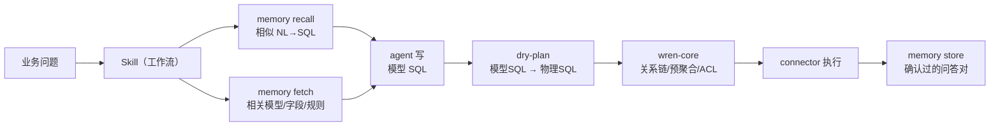

# WrenAI 拆解：它的思路、算法，以及我们能拿走的四件事

> 分析对象：`github.com/Canner/WrenAI`，clone 于 2026-10-27，`wren 0.17.0`（commit `20b69d5`）。
> 目的不是写项目介绍，而是回答一个问题：**同样是「自然语言 → 可信的 SQL → 报表」，它把钱押在哪，我们该跟哪一手。**

---

## 0. 先给结论

1. **它把「AI」删掉了。** v2 把 `wren-ai-service`（意图分类、SQL 生成/纠错流水线）、`wren-ui`、`launcher` 全部移进 `legacy/v1` 分支，只留下**语义引擎 + 上下文层**。NL→SQL 交给用户自己的 coding agent（Claude Code / Cursor / MCP）。
   它只剩一个极薄的 `wren ask`，而且**只渲染提示词、不执行查询**（`cli.md:562`）：`--guided` 给弱模型套严格流程，`--direct` 给强模型几乎不包装；**故意不给默认值**，理由写在文档里 —— "silently changing a default would alter agent behavior across an upgrade"。
   → 判断：**模型是耗材，上下文是护城河。** 和我们的架构（LLM 只产 IR、编译器和校验器定生死）方向一致，但它比我们更彻底：连「对话」都不自己实现。
2. **它把 SQL 当接口，而不是把 IR 当接口。** agent 直接写 `SELECT ... FROM "orders"`（`orders` 是 MDL 里的模型），引擎负责把「模型 SQL」重写成「物理 SQL」：展开 join、注入策略、套 CTE（`wren dry-plan`，不需要连库）。
   → 这是和我们**最大的路线分歧**：我们让 LLM 产 `rpx-query/v1`，它让 LLM 产 SQL，再把 SQL 变正确。
3. **它解决「一对多重复计数」的办法是硬约束 + 自动预聚合**，而我们现在只发一条 warning（`planner.py::_grain_risk` 的原话是「建议先按明细粒度聚合」—— 把活推给了用户）。
   → **这是最值得立刻抄的一条**，下面 §6 给了落地方案。
4. 其余可抄的：**schema 卡片**（把模型渲染成一段紧凑文本喂 LLM）、**记忆的失效键**（`mdl_hash`，口径变了就别再召回旧例子）、**发布前的 default-deny 密钥扫描**。

---

## 1. 它现在是什么（和很多人印象里的 WrenAI 不是一回事）

README 的定位是一句话：**"open-source GenBI for AI agents"** —— 给已有的 agent 一层「被治理的语义层」，让它们生成正确的 SQL 并部署看板。

```
core/
├── wren-core/        Rust 语义引擎（DataFusion 之上），SQL 重写与计划
├── wren-core-base/   manifest 类型（Model/Column/Relationship/View/Cube）+ builder
├── wren-core-py/     PyO3 绑定
├── wren/             Python SDK + CLI（`wren` 命令、memory、skills、genbi）
└── wren-mdl/         MDL 的 JSON Schema
skills/               给 agent 的发现桩（真内容在 CLI 里，随版本更新）
docs/core/concepts/   五层上下文、记忆系统、正确性六支柱
```

**关键信息在 `.claude/CLAUDE.md` 开头**：v1 那套服务整体搬到 `legacy/v1` 了。所以网上讲「WrenAI 的 AI service 有这些 pipeline」的文章，讲的是 v1；v2 的赌注完全换了。

### 查询流（v2）



注意 `dry-plan` 是**离线**的（文档明说 "No database connection required"）。这意味着「计划对不对」可以在**碰数据库之前**判定 —— 和我们「编译期算好对比期窗口、SQL 只带两个日期参数」是同一个思路的两种用法。

---

## 2. MDL：它把「可命名的东西」收紧到只剩模型

MDL（Modeling Definition Language）是 YAML 源码 + 编译产物 `target/mdl.json`，schema 在 `core/wren-mdl/mdl.schema.json`。对象只有五种：

| 对象 | 关键字段 | 作用 |
|---|---|---|
| `models` | `tableReference`、`columns`、`primaryKey`、`uniqueKeys`、`rowLevelAccessControls` | 逻辑数据集（物理表或 SQL） |
| `columns` | `type`、`expression`、`isCalculated`、`isHidden`、**`relationship`**、`columnLevelAccessControl` | 暴露的字段；**`relationship` 让它成为 join 手柄** |
| `relationships` | `models[]`、`joinType`、`condition` | 可复用的 join 逻辑（不是外键） |
| `cubes` | `baseObject`、`measures`、`dimensions`、`timeDimensions`、`hierarchies` | **预聚合语义对象** |
| `views` | `statement` | 具名 SQL，当稳定虚表用 |

三个细节值得记：

- **主键是硬要求**，不是可选元数据：`plan.rs:238` —— `"Primary key not found for model {}. To use TO_MANY relationship, the primary key is required for the base model."` 主键是后面「按主键预聚合」的锚点。
- **关系列是手柄，不是字段**：`docs/core/reference/mdl.md:161` 说 `relationship` 让列成为 "join handle column"；同一个文档 `:197` 明确写了报错样例 `No field named orders.customer.first_name` —— 它只用来声明「从这张表怎么走到那张表」，不能当普通列 select。
- **cube 是「结构化查询」的对象**：`docs/core/reference/mdl.md:303` —— "Cubes are queried structurally via `wren cube query`, not by writing raw `GROUP BY` SQL"。时间维度的粒度是**查询期**给的（`--time-dimension name:granularity`），和我们的 `time_grain` 等价；`hierarchies` 是下钻路径（粗到细）。

**为什么这么设计**：`docs/core/concepts/what_is_mdl.md` 说得很直白 —— "**the agent cannot name what is not modeled**"。没进 MDL 的列，在引擎眼里不存在；于是「猜错表/用错列」从「模型能力问题」变成「结构上不可能」。

**代价**：建模成本高（这也是它为什么要写 `generate-mdl` 技能 + `enrich-context` 的 grill 模式，一步步问出业务含义）。它承认这一点：先说 "scaffold fast"（从 schema 自动生成粗糙 MDL），再 "enrich deep"（补业务含义）。

---

## 3. 算法：关系链、字段下推、TO_MANY 预聚合

这三件事都在 `core/wren-core/core/src/logical_plan/analyze/` 里，是它真正的技术含量。

### 3.1 关系链 = 嵌套 JOIN，带星型回退

`relation_chain.rs:31-35` 把结果定义成一个代数结构：

```
RelationChain = Chain(LogicalPlan, JoinType, condition, Box<RelationChain>) | Start(LogicalPlan)
```

物理形态是 `(((Model3 ⋈ Model2) ⋈ Model1) ⋈ ...)`。`with_chain_with_access_control`（`:90`）沿着一串节点逐个挂 join，每一步：

```rust
let link_index = directed_graph.find_edge(prev, next)      // 优先「上一个节点」出发的边
    .or_else(|| directed_graph.find_edge(start, next));     // 没有就回退到「起点」出发的边
```

注释（`:94-101`）解释了回退的理由：**让一个模型能同时投影跨多条关系的计算列**（星型扇出 `A→B`、`A→C`），不至于在链上被截断。

> 对照我们：`planner._shortest_path` 是在关系图上做 BFS 最短路，只决定「走哪条路」，**不区分线性链和星型扇出**。只要我们一次查询里要连两个都挂在事实表上的维度，就是星型扇出 —— 我们目前靠「边去重 + 按 from/to 排序」凑合，Wren 的 prev/start 双选边是更明确的解法。

### 3.2 字段下推：每个模型只投影它被用到的那几列

同类 Join 只带条件，Wren 还顺手带了「这个模型需要哪些字段」：`model_required_fields: &HashMap<TableReference, BTreeSet<OrdExpr>>`，每个 hop 的目标模型用 `create_schema(fields)` 只建需要的列（`:120-140`）。这是**逻辑计划层的投影下推** —— 在 DataFusion 做物理优化之前就砍掉了列。

> 对照我们：`sqlgen.py` 的 SELECT 只取维度/度量用到的列（这点一样），但每个 hop 是**直接 JOIN 物理表**，没有「按需投影的子查询」。对物理表无所谓；一旦 bizmodel 支持 `view`（SQL 定义的模型），同一个 view 会被整段嵌进每次 join，代价就出来了。

### 3.3 TO_MANY 预聚合：把「重复计数」变成结构上不可能

这是我最想抄的一段。三处证据串起来看：

1. `plan.rs:491`：
   ```rust
   fn is_to_many_calculation(&self, expr: Expr) -> bool {
       !find_aggregate_exprs(&[expr]).is_empty()
   }
   ```
   —— 一个计算列里**有没有聚合函数**，决定了它是不是「跨一对多」的算法。
2. `plan.rs:512 create_partial_calculation`：给这个计算列单独建一个 `CalculationPlanNode`（partial model plan），并显式收集它需要的字段。
3. `plan.rs:553-556` 的注释把规则说死了：
   > "Default use the primary key of the model as the required field for the partial model … It's always used when the `TO_MANY` calculation is used, **because the result of `TO_MANY` calculation is always grouped by the primary key of the source model**."

配套的文档规则（`docs/core/reference/mdl.md:239`）：
> "For `TO_MANY` relationships, calculated columns that traverse the relationship **must use aggregate functions** — the engine wraps the join in an aggregate subquery to prevent row multiplication."

翻成大白话：

- 你想「订单金额 + 明细数量」放在一张表里，如果直接 join 明细，订单金额会被明细行数放大；
- Wren 的做法是：**先把明细按订单主键聚合成一行，再 join 回订单**；所以这个计算列必须写成聚合（`SUM(...)`），否则编译期就拒绝；
- 于是「放大」从「运行后数字不对」变成「写不出来」。

**我们的现状**：`planner._grain_risk` 只产一条 warning：

```python
"what": "度量 %s … 会放大行数（%s）：订单金额会被明细行数重复累加 ——
         建议先按明细粒度聚合，或改用可加度量"
```

也就是说：**我们告诉用户「你可能会错」，然后照错算。** 这是当前语义层最大的正确性缺口。

---

## 4. 上下文层：五层模型 + 三原语记忆

`docs/core/concepts/what_is_context.md` 把「上下文」拆成五层，比业界常说的「语义层」宽一档：

| 层 | 回答什么 | Wren 落在哪 | 我们的对应物 |
|---|---|---|---|
| Structural | 有什么数据 | MDL models/columns/relationships | `rpx-bizmodel` 的 entities/dimensions |
| Semantic | 数据什么意思 | MDL metrics（cube measures）/calculated/enum 标签 | `bizmodel.metrics/dimensions` + `aliases` |
| Business | 这家公司什么意思 | `knowledge/rules/`、MDL 里的 canonical 表 | `bizmodel.rules`（目前只靠人工） |
| Operational | 怎么用才安全 | RLAC/CLAC、approved joins | **没有** |
| Behavioral | 以前什么做对了 | `knowledge/sql/*.md` + memory index | `rpx/goldens/<dsn>/` |

### 记忆的三原语（真正的设计在「索引什么」，不在「排序算法」）

- `memory recall -q "..."` → 相似 NL→SQL 对（few-shot）
- `memory fetch -q "..."` → 相关模型/字段/关系/规则（schema linking）
- `memory store` → 确认过的问答对写回 `knowledge/sql/*.md`

实现很朴素：`memory/store.py:414 recall_queries` 就是**向量检索 + 元数据过滤 + top-K**，没有 rerank、没有 hybrid score。真正的巧思在三处：

1. **索引粒度 = 语义对象**（`memory/schema_indexer.py:311 extract_schema_items`）：模型、列、关系、视图、cube、measure、dimension、timeDimension **各一条**，每条带 `model_name / item_type / mdl_hash` 元数据。这样「只召回 customers 的三列 + 一条关系」，而不是整张 schema 灌进 prompt。
2. **两条路：小库直接贴、大库才检索**。`schema_indexer.py:94 describe_schema()` 把整个 MDL 渲染成一段 `### Model: x / ### Relationship: y / ### Cube: z` 的纯文本，注释写着 "Designed to be pasted directly into an LLM prompt when the schema is small enough"，配一个 `SCHEMA_DESCRIBE_THRESHOLD`。**能贴就别检索** —— 检索是为了省 token，不是为了炫技。
3. **失效键 `mdl_hash`**：检索时按 `mdl_hash` 过滤（`store.py:346`），口径一变，旧索引自动不命中。这条看着小，其实是「记忆不会教坏模型」的关键 —— 我们的 `goldens` 现在**没有这个键**：bizmodel 改了表达式，旧金样例照样被召回，等于用错口径的答案当范例。这是个真 bug 级风险。

### 双后端：能退化成 grep

没装 `memory` extra 时，它用**词法重合 + 子串**在 markdown 上直接搜（`memory_system.md` 的表），装了才用 LanceDB 向量。它是「零依赖可用，装了更好」。我们的 `goldens.search` / `library/search.rs` 已经是 CJK 二元滑窗 + 命中计数，对中文比它的 grep 后端强，但**没有向量选项**（离线优先，这是我们的取舍，不必改）。

---

## 5. 两个「软」但重要的设计

### 5.1 Skills：把工作流写成文件，让 agent 跳不了步

`skills/README.md` 只发一个「发现桩」（告诉 agent 有这么个 CLI），真正的 SKILL.md 从 CLI 里取 —— 好处是**内容永远和安装的版本一致**。

`core/wren/src/wren/skills_content/` 有五个技能：`onboarding` / `generate-mdl` / `enrich-context` / `usage` / `genbi`。它们的写法很值得学：

- `enrich-context/SKILL.md` 开头是 **"Hard rules — READ FIRST"**，然后才是流程；
- 明确分 **grill 模式**（一次只问一个业务问题，答完就 patch MDL）和 **auto-pilot 模式**（把 PDF/词汇表丢进 `raw/`，agent 提改动、等人审）；
- `generate-mdl` 分 `Phase 0..4`，每步都有「先检测已存在项目」「类型归一化」「写文件」的具体命令。

`ask_templates/guided.md.tmpl`（21 行）更直接 —— **任务类型分流**（`--direct` 版只有 4 行，几乎不包装）：
```
TASK TYPE A — data question:
  1. wren context show      # 看模型
  2. wren memory recall     # 相似历史
  3. 用模型名写 SQL（不许用物理表名）
  4. wren dry-plan          # 验证
  5. wren query             # 执行
  6. 用自然语言回答
Constraints: 只用模型名；绝不猜列名；凭据只走 .env
```

> 对照我们：`rpx/pi-skill/rpx-report/SKILL.md` 是单文件、单流程。可以照它改成「先分流（问答 / 建模 / 排查）、再给硬规则、最后给不可跳步的步骤」。

### 5.2 治理放在计划期，不放在提示词里

- **RLAC**（行级）：规则是 SQL 表达式，可引用**会话属性** `@user_id`，甚至可写子查询（`access_control/mod.rs:47-57` 明确说「子查询里的标识符属于另一个作用域，要在子查询分析时再解析」）。注入点在 `ModelPlanNode` 构建时（`plan.rs:467 build_rlac_filter`），循环依赖会被检测。
- **CLAC**（列级）：`mdl.schema.json` 里是 `operator + requiredProperties + threshold` 的结构，同样按会话属性判定。

**要点不是它的具体语义，而是「策略以数据形式存在模型里，在计划期注入，审计能看到」**。我们的 `docs` 里「行列级权限」一直挂在未做清单上 —— 这是最值得补的一块，而且我们的架构（IR → planner → sqlgen）注入点比它更干净：planner 直接把策略表达成 `filters[]`，sqlgen 参数化，不用碰 SQL 文本。

### 5.3 发布前的 default-deny 密钥扫描

`core/wren/src/wren/genbi/verify.py` 头注释：

> "Secret scanning is **DEFAULT-DENY**: scan every file except known binary/data formats. An allowlist of text suffixes loses the race against whatever extension an agent picks next (.env, .ts, .vue, …)."

部署 gate 挂在这个 verifier 上。我们的「保存版本 / 发布」正好缺这一道 —— 而且我们的模板里带 `sql.dsn`（数据源名）和 `dataset.sql`，一旦有人把口令内联进 SQL 再发布，就是事故。

---

## 6. 我们 vs 它：一张对照表

| 维度 | WrenAI v2 | rpx / Report Studio | 判断 |
|---|---|---|---|
| **接口** | SQL（对模型写），引擎重写 | `rpx-query/v1` IR，编译器生成 SQL | 各有理：IR 好校验/好审计，SQL 好写/模型熟。见 §7 |
| **语义层** | MDL：model/relationship/cube/view，**主键硬要求** | bizmodel：entity/metric/dimension/relationship/rules | 我们缺 **cube** 与 **主键约束** |
| **指标** | cube 的 measure（无独立 metric 对象） | 独立 `metrics[]`（有 status/evidence/aliases） | **我们更对**：报表需要稳定的指标身份与版本 |
| **一对多** | 强制聚合 + 按主键预聚合子查询 | 只 warning | **必须抄** |
| **join 路径** | 关系列声明 + 关系链（prev/start 双选边） | BFS 最短路（自动，但不可控） | 中期加「首选路径」 |
| **权限** | RLAC/CLAC，计划期注入 | 无 | 补 |
| **上下文** | 五层 + memory 三原语 + `mdl_hash` | bizmodel + goldens（无失效键） | 补失效键 |
| **输出** | SQL 结果 + 看板（genbi 855 行） | **报表**：六形态 + 模板 + 打印导出 | **这是我们的护城河** |
| **正确性** | dry-plan（离线）+ 六支柱 | IR 校验 + 双层只读校验 + 24 条回归集 | 我们更靠前；缺「离线计划预览」给 agent |

一句话：**它解决「agent 怎么安全地问数」，我们解决「问出来的数怎么变成能打印的报表」。** 前者是它的主场，后者的复杂度它基本没碰（genbi 只有 855 行，而我们的 shapes+模板+打印链路是几万行）。

---

## 7. 可复用清单

按「立刻能做 → 值得排期 → 战略选择」分三档。每条都给了落点与判据，避免变成「看起来很美好」的清单。

### P0（本周，2 天内）

| # | 抄什么 | 落在我们的哪 | 判据 |
|---|---|---|---|
| 1 | **`grain` 预聚合**：跨放大边的度量改成「先按事实表主键聚合的子查询」再 join | `sqlgen.py` 的 fact 发射；`planner` 已有 `grain_risk` 可直接当开关。⚠ 前提是模型里有主键：`entities[].grain.key` 能记（`fetch_key_meta` 三方言都覆盖），但**没当硬约束**；demo 库那张 `sales` 本身没主键，模型里记的是 `no_primary_key` | 新增夹具「订单 × 明细」：当前 SUM 被放大 N 倍，改后与按订单聚合一致；24 条回归集不回归；无主键时**拒绝**而不是猜 |
| 2 | **schema 卡片**：把 bizmodel 渲染成一段紧凑文本（模型/字段/指标/关系/枚举值），给 LLM 与 Pi 用 | `bizmodel.py::describe(model) -> str`，挂 `GET /api/datasources/<id>/context` | 同一句话：JSON 上下文 vs 卡片上下文，比 token 数与命中率（用 `questions.json` 里 8 条跑） |
| 3 | **金样例加失效键**：golden 里存 bizmodel 指纹，召回时过滤 | `goldens.py`（写入时存 `semantic.hash`，检索时先比） | 改掉一个指标的表达式后，旧 golden 不再被召回（单测可钉） |
| 4 | **发布前 default-deny 密钥扫描** | `versions.publish` 之前加一道 `scan_secrets(files)` | 往 spec 里塞一个 `postgres://u:p@h/db`，发布被拒 |

### P1（一周级，值得排期）

| # | 抄什么 | 落点 | 判据 |
|---|---|---|---|
| 5 | **cube（多维集）**：`cubes[] = {base, measures[], dimensions[], time_dimensions[], hierarchies[]}` | `bizmodel` + `planner` 校验「维度组合是否属于该 cube」 | 用 demo 库定义 1 个销售 cube；`hierarchies` 驱动归因分析的**下钻顺序**（替换现在硬编码「前两个文本维度」） |
| 6 | **主键约束**：声明 `primaryKey` 才能用一对多 | `bizmodel` 校验 + 发现流程补 `fetch_key_meta`（已有） | 没有 pk 的模型上做一对多 → 编译期拒绝，报错点名 |
| 7 | **RLAC**：`row_policies[] = {name, condition, props[]}`，planner → `filters[]` | `planner` 注入 + `sqlgen` 参数化 + 审计记「命中策略」 | 用 `as_of`/会话属性造两个用户，同一查询出不同行；SQL 里能看到策略条件 |
| 8 | **首选 join 路径**：`relationships[].preferred_for: [metric/dim]` | `planner._shortest_path` 里加权重 | 两条到同一维度的路径时，选声明的那条（现在选最短的） |
| 9 | **离线计划预览**：`POST /api/datasources/<id>/plan` 已存在，补**人可读的展开说明**（用了哪些 join、注入了什么过滤、为什么） | `planner` 输出 `explain[]` | 一份计划能回答「这张表为什么这么算」，不用看 SQL |

### P2（战略选择，要先讨论）

| # | 选项 | 代价 | 收益 |
|---|---|---|---|
| 10 | **把 SQL 变成一等接口**：允许 agent 直接写 `SELECT ... FROM <bizmodel 视角的表>`，我们做 AST 改写（模型名 → 子查询、指标列 → 聚合表达式、关系列 → join） | 要写一个 sqlglot 改写器（约 1500–2500 行）+ 全套单测；和现有 IR 并存，不能替换 | LLM 写 SQL 的熟练度远高于写我们的 IR；对外更像「标准 BI 语义层」，客户能带走 |
| 11 | **skills 化**：把「取上下文 → 写 IR → 校验 → 编译 → 执行 → 回灌」写成带硬规则的分流技能 | 1 天（重写 `rpx/pi-skill`） | agent 不能跳步；比在系统提示里写一遍更稳 |

---

## 8. 不建议照搬的

1. **DataFusion 那一套引擎**。它是「用一个通用查询引擎 + analyzer rule 做语义层」，我们是「自己算报表」。我们的引擎能出套打、分页、交叉表、边框 —— 这是它没有的。换引擎等于换产品。
2. **22 个 connector**。我们的三方言 + 原生驱动已经够，且驱动层刚踩完 `AnyPool` 的坑。
3. **砍掉独立 metric 对象**。它的 metric 藏在 cube measure 里，适合「问答」，不适合「报表」——报表要的是稳定的指标身份、口径版本、别名与状态（confirmed/candidate）。这块我们比它对。
4. **纯向量检索**。它的 grep 后端对中文基本不可用；我们的 CJK 二元滑窗 + 命中计数在离线场景更靠谱。要加向量也只作为**可选**后端，不能让离线路径退化。
5. **agent-first 的交付形态**。它是 CLI + 技能，没有 UI；我们的价值有一半在「设计器 + 打印」这条链上，不能为了「agent native」把它砍掉。

---

## 9. 如果让我重新设计

我会做一件它没做的事：**把 `grain` 变成类型系统的一部分**。

它的解法是「TO_MANY 的计算列必须带聚合」—— 一条**运行时规则**（编译期检查，但语义上没有类型）。我们可以更进一步：给每个指标标一个 `grain`（事实表粒度 / 可加 / 半可加 / 不可加），给每个维度标一个 `grain`，`planner` 在拼计划时做**粒度代数**：

- 事实粒度 ⋈ 事实粒度（同主键）→ 不变；
- 事实粒度 ⋈ 明细粒度（放大边）→ 要么报错，要么**自动加一层按主键聚合**（Wren 的做法）；
- 聚合后 ⋈ 任何维度 → 安全。

这样「重复计数」不是靠一句话警告、也不是靠一条规则，而是**类型检查**。我们在 `planner._grain_risk` 里已经有 `duplicate_count` 这个判断了 —— 差的只是把它从 warning 升级成「改计划」。

顺带说一句：这件事做完，我们的「口径可解释」会比 Wren 更强 —— 因为它只能说「用了哪个模型」，我们能说「这个数字是在哪个粒度上聚合的、中间经过几次预聚合」。

---

## 10. 一句话收尾

WrenAI 值得学的不是它的 AI（它自己都删了），而是它**把「模型能猜错的地方」一个个堵死**的手法：不可命名的对象不存在、放大粒度的计算写不出来、口径变了旧例子失效、发布前默认拒绝。这些都不需要模型更聪明，只需要工程更狠。

我们该抄的就是这四刀。
