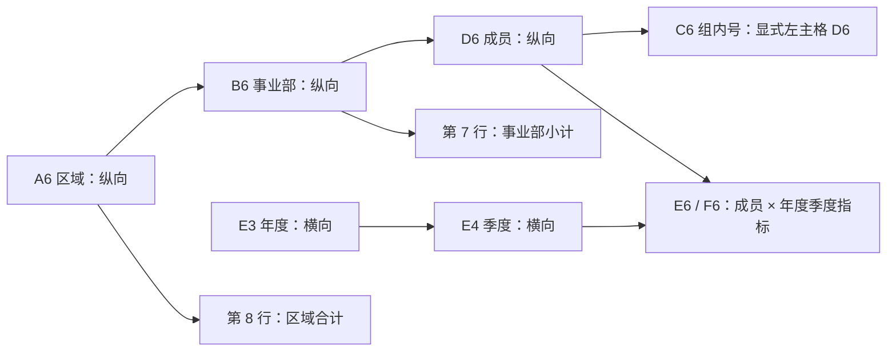

# 复杂主格交叉扩展示例

同时选择 [complex-master-expansion.json](complex-master-expansion.json) 和
[complex-master-sales.csv](complex-master-sales.csv)，点击「运行生成报表」，再进入「图形与打印预览」。
也可以先只打开 JSON，在 Web 的「模板设计」中修改公式、扩展方向和主格，再在右侧上传 CSV。
保存与运行流程见 [Web 报表模板设计](../../docs/web-template-designer.md)。
数据文件为 UTF-8、TAB 分隔，共 64 笔交易；版面为 A3 横向。

## 看什么

模板只有 **12 行 × 11 列、47 个定义格**，通过主格关系展开成 **23 行 × 25 列**：

- 纵向三层：2 个区域 → 每区 2 个事业部 → 共 8 个成员实例。
- 横向两层：2025 / 2026 → 各 4 个季度 → 每季收入、毛利两个指标。
- 每个成员与每个季度交叉取数，共 128 个指标格。
- 4 个事业部小计、2 个区域合计、1 个公司总计。
- 部内序号、部内收入排名、部内收入占比、全表连续序号。

「直销部」「渠道部」在两个区域中重复，成员「陈晨」「林悦」也跨组重复。
分组必须以主格管辖范围为准，不能仅凭名称把不同组织的数据混在一起。

## 主格结构

箭头表示「主格 → 附属格」；以下格号都是扩展前的模板地址。



`C6` 位于 `D6` 左边，却把 `left_head` 指向 `D6`。
这是人为声明主格的关键场景：**左主格是关系名称，不要求主格位于左边**。
展开后 `C6` 是每名成员独立的一格，没有被拉成一个大合并格。

| 模板格 | 表达式 | 左主格 | 上主格 | 作用 |
| --- | --- | --- | --- | --- |
| A6 | `ds1.group(region)` | 根 | 根 | 区域纵向扩展 |
| B6 | `ds1.group(department)` | A6 | 根 | 当前区域内的事业部 |
| D6 | `ds1.group(employee)` | B6 | 根 | 当前事业部内的成员 |
| C6 | `&D6` | **D6（在右侧）** | 根 | 每个事业部内从 1 编号 |
| E3 | `ds1.group(year)` | 根 | 根 | 年度横向扩展，标题覆盖两列 |
| E4 | `ds1.group(quarter)` | 根 | E3 | 当前年度内的季度，标题覆盖两列 |
| E6 | `ifn(ds1.sum(amount),0)` | D6 | E4 | 成员与年度季度交集的收入 |
| F6 | `ifn(ds1.sum(profit),0)` | D6 | E4 | 同一交集的毛利 |
| G6 / H6 | `ds1.sum(amount)` / `ds1.sum(profit)` | D6 | 根 | 成员两年合计，不随季度复制 |
| I6 | `count(G6[B6]{G6>$G6})+1` | D6 | 根 | 当前事业部内按两年收入排名 |
| J6 | `int(G6*1000/sum(G6[B6]{})+0.5)/10` | D6 | 根 | 部内占比，单位 %，四舍五入到一位小数 |
| K6 | `seq(D6)` | D6 | 根 | 跨区域、事业部连续编号 |

模板中的根主格采用默认认定；没有给 `left_head` / `top_head` 填一个不存在的格号。
两个横向扩展格明确声明 `horizontal`；三个纵向扩展格明确声明 `vertical`；
指标格明确声明 `none`，由两条主格链共同带动复制。

## 同一个公式，三个汇总范围

下面三格的公式都是 `sum(E6{})`，且都指定 `top_head: "E4"`，所以季度相同；
只有左主格不同：

| 模板格 | 左主格 | 计算范围 |
| --- | --- | --- |
| E7 | B6 | 当前区域、当前事业部、当前年度季度 |
| E8 | A6 | 当前区域、当前年度季度 |
| E9 | 根 | 全公司、当前年度季度 |

`G7 / G8 / G9` 也使用同一个 `sum(G6{})`，分别计算事业部、区域、公司两年收入。
报表底部保留了这些关系的简短提示。

## 手工核对结果

| 组织 | 两年收入 | 两年毛利 | 成员实例数 |
| --- | ---: | ---: | ---: |
| 华东 / 直销部 | 3,915 | 975 | 2 |
| 华东 / 渠道部 | 3,120 | 780 | 1 |
| 华东合计 | 7,035 | 1,755 | 3 |
| 华南 / 直销部 | 13,500 | 3,375 | 3 |
| 华南 / 渠道部 | 13,440 | 3,360 | 2 |
| 华南合计 | 26,940 | 6,735 | 5 |
| 公司合计 | **33,975** | **8,490** | **8** |

- 组内序号应为 `1,2 / 1 / 1,2,3 / 1,2`；全表序号应为 `1..8`。
- 华东 / 直销部 / 林悦的 2026 Q2 有两笔收入 `220 + 75`，交叉格应为 **295**，毛利 **70**。
- 华南 / 直销部 / 江浩缺少 2025 Q3，收入、毛利都应为 **0**；其两年收入应为 **4,860**。
- 华东直销部排名：陈晨第 1、林悦第 2；华南直销部排名：江浩第 1、苏晴第 2、陈晨第 3。
- 「序号 / 人数」列在明细中是全表序号，在小计和合计中是该范围的成员实例数。
  公司人数不能对成员姓名去重，否则跨组织同名成员会被错误合并。

## CLI 运行

从仓库根目录执行已安装的命令：

```bash
rpx run examples/tutorial/complex-master-expansion.json \
  --out-dir /tmp/complex-master-run --export xlsx --export csv
rpx result inspect /tmp/complex-master-run/artifacts/result.json --origin G9
```

也可以用 `rpx library init /tmp/tutorial-reports --presets` 创建含本例的共享报表库，
由 agent 执行 `report run complex-master`，再通过 Web 查看固定结果。
本例设置了 420 × 297 mm 自定义纸张，打印文件使用浏览器「打印 / 保存为 PDF」。
`--export print-xlsx` 当前拒绝自定义纸张；普通数据 Excel 使用 `--export xlsx`。

## 本次验收产物

浏览器截图、PDF 和数据 Excel 在 `output/playwright/complex-master-expansion.*`。
从 CSV 独立求和，核对了所有成员交叉指标、两级小计、总计、排名、占比及序号；
Excel 数值另从实际 OOXML 文件读回比对。
核对摘要在 `output/tutorial/complex-master-verification.json`。
